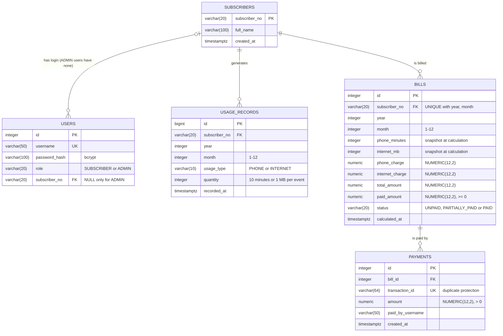

# ER / Data Model — Billing Database (PostgreSQL)

Image version: [`er-diagram.png`](er-diagram.png) / [`er-diagram.svg`](er-diagram.svg). Both diagrams show exactly the tables created by [`billing_api/app/models.py`](../billing_api/app/models.py).

## Constraints and indexes

| Table | Constraint / index | Purpose |
|---|---|---|
| `bills` | `UNIQUE (subscriber_no, year, month)` | One stored bill per subscriber per month; Calculate Bill updates it |
| `payments` | `UNIQUE (transaction_id)` | Duplicate transaction IDs are rejected even under concurrent requests |
| `payments` | `CHECK (amount > 0)` | No zero/negative payments |
| `bills` | `CHECK (paid_amount >= 0)`, `CHECK (month BETWEEN 1 AND 12)` | Data integrity |
| `usage_records` | `INDEX (subscriber_no, year, month)` | Fast aggregation for Calculate Bill and paging for Query Bill Detailed |
| `usage_records` | `CHECK (quantity > 0)`, `CHECK (month BETWEEN 1 AND 12)` | Data integrity |
| `users` | `UNIQUE (username)`, `CHECK (role = 'ADMIN' OR subscriber_no IS NOT NULL)` | Each subscriber login is linked to exactly one account |

Money is stored as `NUMERIC(12,2)` (exact decimal, never floating point). Usage is stored as integer
minutes and MB, so all bill calculations are exact integer arithmetic.
